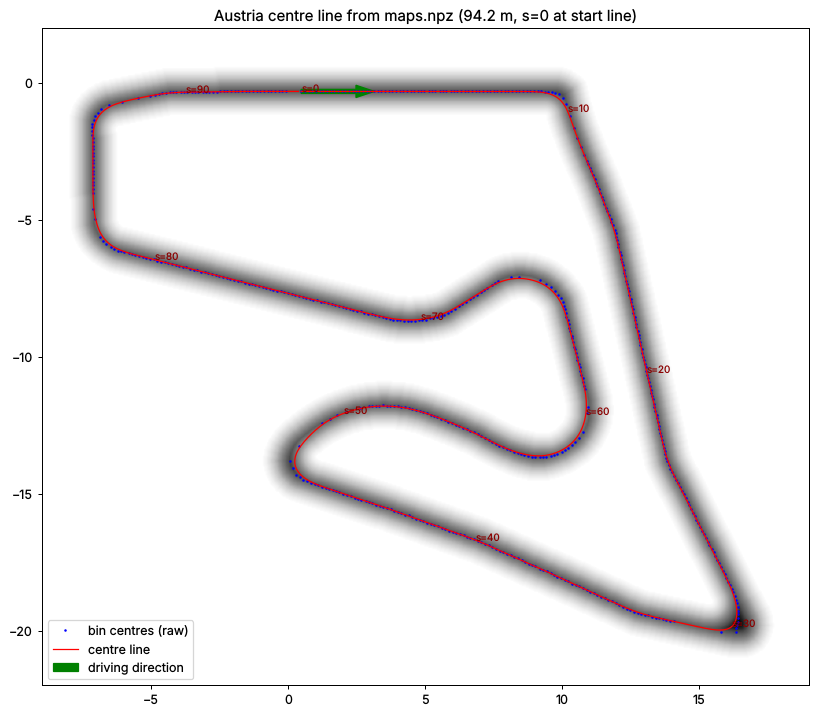
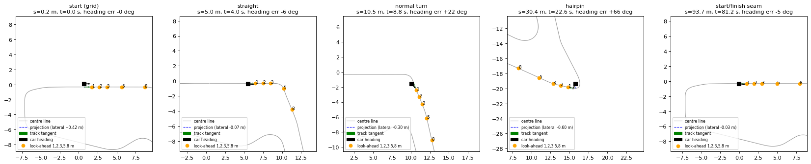

# DQN + track features

I added track-relative inputs to the existing DQN. The code is tested, and I trained track for 200k decisions with seed 0. Lookahead is implemented but hasn't had a full training run yet.

The idea is to help with the Austria hairpin, where the earlier runs kept stopping around 35%. Track features tell the car how far it is from the road centre and how its heading and speed compare with the road direction.

This uses a static map plus current pose and velocity. No episode info fields, future car states or expert actions are used as inputs.

## Inputs

All modes keep the camera, pose, velocity, acceleration and time.

| mode | extra input |
|---|---|
| base | none |
| lidar | LiDAR readings |
| track | 5 track-relative values |
| track-lookahead | track + 10 lookahead values |

Actions, reward and training settings stay the same: 15 actions, progress reward, stop on wall contact, 120 s limit, action repeat 4, grid start and hidden layers `[64, 64]`.

## How it works

`tools/build_centerline.py` builds a centre line from the drivable area and static progress map in `maps.npz`. It finds points away from walls, smooths them and samples roughly every 0.1 m. The saved line has 942 points over 94.2 m.

Each step, `Agents/track_features.py` finds the closest centre line segment and adds:

| feature | meaning |
|---|---|
| lateral_offset | distance from the line, positive left, divided by 1.5 m |
| sin_heading_error | sin of car heading minus road heading |
| cos_heading_error | cos of the same angle |
| v_along_track | speed along the road, divided by 5 m/s |
| v_across_track | sideways speed, positive left, divided by 5 m/s |

Sin and cos avoid the angle jump at ±180°. Velocity starts in the car frame and is converted to the road direction.

Lookahead adds centre line points 1, 2, 3, 5 and 8 m ahead along the road. Each gives x forward and y left relative to the car, divided by 8 m. That's 10 values. In a hairpin, some points can be beside or behind the car.

Training and eval use the same code. Added values are clipped to [-3, 3], with 0 clipped so far. Invalid inputs raise an error. Eval and resume check the feature settings and centre line hash in `config.json`.

## Checks

- 40 tests passed, including 12 for track features.
- About 23,500 map positions were checked, with no wrong-side hairpin matches found.
- `tools/track_geometry_check.py` checks the features during an FTG lap.




## Results

Same M1 Mac, 200k decisions, training seed 0, action repeat 4, grid start, no demos. Checkpoints were picked on validation seeds 0–9, then tested on 100–109.

| model | checkpoint | progress mean ± std | laps | crashes / timeouts | passed hairpin |
|---|---|---|---|---|---|
| base | 200k | 21.9% ± 9.2 pp | 0/10 | 8 / 2 | 0/10 |
| LiDAR | 140k | 35.3% ± 0.2 pp | 0/10 | 10 / 0 | 0/10 |
| track | 140k | 34.4% ± 0.9 pp | 0/10 | 9 / 1 | 0/10 |

Passing the hairpin means reaching 3 m past its apex along the centre line. None passed. The apex is already around 35.1% progress, so reaching 35% doesn't mean getting through it.

Track reached the hairpin more consistently than base in this run. It ended up close to LiDAR, but one training seed isn't enough to rank them. The timeouts were cars stopping, not successful runs.

Track’s mean training reward rose from 3.1 at 20k decisions to 23.9 at 200k. For comparison, the base AR4 run ended around 10 and the LiDAR AR4 run around 26 (logs/dqn/DQN_6, logs/dqn_lidar/DQN_4), so track learned about as well as LiDAR and much better than base. Evaluation still varied a lot between checkpoints, so using validation to choose one matters.

Action timing may also be an issue: the earlier FTG check only finished 3/10 laps with DQN's actions and 4-step decisions. Lookahead still needs testing before drawing conclusions about the inputs.

Results are in `results/val_ar4_track/`, `results/test_ar4/` and `results/test_ar4_reeval/`.

## Run

```bash
python train.py --obs-mode track --action-repeat 4 --target-update-interval 2500 --timesteps 200000 --seed 0 --save-path models/dqn_track_ar4_long --eval-every 10000 --resume-every 50000
```

Add `--resume` after an interruption. For lookahead, change the mode to `track-lookahead` and use a separate save path.

Validate checkpoints:

```bash
for s in $(seq 10000 10000 200000); do
    python evaluate_sb3.py --model models/checkpoints/dqn_track_ar4_long/eval/dqn_track_ar4_long_${s}_steps.zip --obs-mode track --action-repeat 4 --episodes 10 --seed 0 --workers 4 --out results/val_ar4_track
done

python tools/dqn_diagnose.py evals results/val_ar4_track
```

Test the selected model, 140k for this run:

```bash
python evaluate_sb3.py --model models/checkpoints/dqn_track_ar4_long/eval/dqn_track_ar4_long_140000_steps.zip --obs-mode track --action-repeat 4 --episodes 10 --seed 100 --workers 4 --out results/test_ar4
```

`tools/plot_trajectories.py` takes a result JSON and plots the drive. `python tools/dqn_diagnose.py curves` shows training rewards.

## Still to do

Train lookahead and repeat with more training seeds. Use fresh test seeds for the final check. If the hairpin remains a problem, test action timing separately.

These results use one training seed and one Mac. Track modes need a map, unlike base and LiDAR. Smoothness is only comparable at the same action repeat. The original time input still exceeds its declared [0, 1] range in all modes.